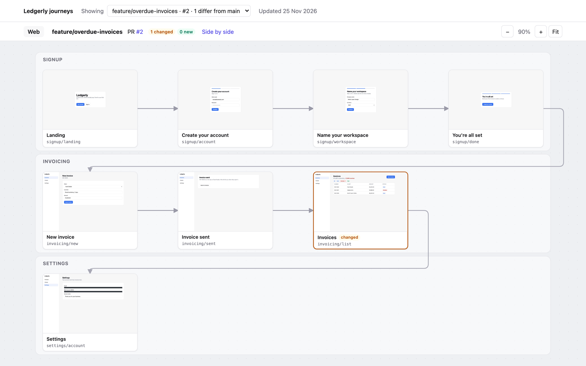

# journeyboard

**Every screen of your app, by user flow, versioned.** Your Playwright tests already walk through the product.
journeyboard keeps a picture of each screen they pass. Each pull request gets a comment showing the screens it
changes, before and after. A board shows the whole product flow by flow, with each screen's history.



**[See the live demo board](https://romannovosad.github.io/journeyboard/)**, built by this repository's own CI
from the small demo app in [`examples/demo`](examples/demo). Open a pull request here and it gets the comment too.

It's for the people who ask "what does sign-up look like right now?" and "what did this PR change for the user?":
designers, PMs, founders, reviewers. It isn't a visual-regression tool. It never fails a build over a pixel. It
just keeps the record.

- **In every pull request:** a comment with the screens it changes and adds, next to how they look on `main`.
- **A board:** every flow as a lane, screens in the order a user meets them, arrows between them. Pick a pull
  request and the screens it touches light up. Open "Side by side" for before/after.
- **History:** every screen keeps every version that reached `main`, with the pull request that changed it.
- **Design mockups:** publish mockups for a branch and they sit next to the screens they're meant to replace.

Everything stays in your GitHub repository, on a branch of its own. No account, no service, no upload anywhere.

## Quick start

You need Playwright tests. If you don't have any, [set Playwright up](https://playwright.dev/docs/intro) first.

```bash
npx github:romannovosad/journeyboard init
npm i -D github:romannovosad/journeyboard#v0
```

`init` writes two GitHub workflows and a `journeyboard.config.json`, and never overwrites a file you already
have. Then pick how screens get captured. There are two ways, both described under
[Capturing screens](#capturing-screens). The quickest one needs no code changes. Add this to
`playwright.config.ts`:

```ts
reporter: [['list'], ['journeyboard/reporter']],
use: { screenshot: 'on' },
```

Commit and open a pull request. The comment appears when the tests finish.

**The board** is a static site that the second workflow publishes to GitHub Pages. Turn Pages on once in the
repository's Settings → Pages → Source: **GitHub Actions**, or from a terminal:

```bash
gh api -X POST repos/OWNER/REPO/pages -f build_type=workflow
```

## Capturing screens

### Option 1: no code changes (the reporter)

Every passing test's screenshot becomes a screen. The test file is the flow and the test's title is the step.
Tests in one file follow each other in file order. That's enough to get going, and you can switch individual
tests to `snap` later.

```ts
// playwright.config.ts
export default defineConfig({
  reporter: [['list'], ['journeyboard/reporter']],
  use: { screenshot: 'on' },
});
```

Options: `['journeyboard/reporter', { tag: '@journey' }]` keeps only tests with that tag.

### Option 2: name the screens yourself (`snap`)

Put a `snap()` call where a user would stop and look. You choose which screens matter, their names, and their
order.

```ts
import { test, expect } from 'journeyboard/playwright';

test('a new customer signs up', async ({ page, snap }) => {
  await page.goto('/');
  await snap('signup/landing', { title: 'Landing' });
  await page.getByRole('link', { name: 'Get started' }).click();
  await snap('signup/account', { title: 'Create your account' });
});

test('sends the first invoice', async ({ page, snap }) => {
  await page.goto('/invoices/new');
  // `from` draws an arrow from a screen in another flow: this is where users come from.
  await snap('invoicing/new', { title: 'New invoice', from: 'signup/done' });
});
```

Names are `flow/step` in lower-case words joined by hyphens. Without `JOURNEYBOARD_SHOTS` set, as when you run
tests on your own machine, `snap` does nothing and costs nothing.

If you already have your own `test` with fixtures, add `snap` to it:

```ts
import { test as base } from './fixtures';
import { withSnap } from 'journeyboard/playwright';

export const test = withSnap(base, {
  requireTag: '@journey',                            // every test using snap must carry this tag
  prepare: async (page) => page.clock.setFixedTime(new Date('2026-01-15T09:00:00Z')),
  beforeSnap: async (page) => page.evaluate(() => document.fonts.ready),
  mask: ['.avatar', '[data-testid=balance]'],        // painted over on every picture
  fullPage: false,
  quality: 80,
});
```

### Hiding personal data

Anything with a `data-journeyboard-mask` attribute is painted over in every picture. Put it on names, emails,
account numbers and amounts. With `snap` you can also pass `mask` selectors, as shown above. Fix the clock in
`prepare` so dates don't change every run.

## How it works

```
pull request ──▶ tests take pictures ──▶ journeyboard-data branch ──▶ comment on the PR
merge to main ──▶ tests take pictures ──▶ they become the baseline; the old ones go into history
                                     └──▶ the board site rebuilds
```

The pictures live on an orphan branch, `journeyboard-data`, in your own repository. It's created on the first
run. It has no shared history with your code, so it never shows up in your branches' diffs or clones of `main`.
The images in PR comments link to that branch, so anyone who can read the repository can see them, including on
private repositories. A pull request's pictures are removed from the board when it closes. Each screen's
history keeps every version that reached `main`.

## Configuration

`journeyboard.config.json` at the repository root. Every field is optional.

| Field | Default | What it does |
|---|---|---|
| `title` | `Journeys` | The board's title |
| `baseBranch` | `main` | What pull requests are compared against, and where the baseline comes from |
| `platforms` | `[{"id":"web","label":"Web"}]` | Boards to keep apart (for example `web`, `desktop`, `ios`), in display order. Add `"repo"` when another repo captures that platform. |
| `dataBranch` | `journeyboard-data` | The branch the pictures live on |
| `dataRepo` | this repo | Keep the pictures in another repository (see below) |
| `siteUrl` | the repo's GitHub Pages address | Where the board lives, for links in comments |
| `owner` | this repo's owner | Used to link pull request numbers on the board |

The GitHub Action's inputs override the file. See [`action.yml`](action.yml).

## The board site

The generated `journeyboard-site.yml` rebuilds the board whenever new pictures land and deploys it to GitHub
Pages.

- **Public repositories:** Pages is public, and so is the board.
- **Private repositories:** on GitHub Enterprise Cloud you can make Pages private (Settings → Pages →
  Visibility), so only people with access to the repository can open it. On other plans a Pages site is public,
  so host the board somewhere you can put a login in front of, or skip the site. The PR comments work either way.
- **Anywhere else:** `npx journeyboard build --data <checkout of journeyboard-data> --out site` produces a plain
  folder of static files. Upload it to any static host, or open `site/index.html` straight from disk.

## Several repositories, one board

If a product spans repositories (a web app and a desktop app, say), keep the pictures in one shared repository.
Each code repository then publishes into it:

```json
{ "dataRepo": "acme/journeys", "platforms": [
    { "id": "web", "label": "Web", "repo": "acme-web" },
    { "id": "desktop", "label": "Desktop", "repo": "acme-desktop" } ] }
```

```yaml
- uses: romannovosad/journeyboard@v0
  with:
    command: pr
    platform: desktop
    token: ${{ steps.app-token.outputs.token }}   # a GitHub App or fine-grained token that can push to acme/journeys
```

The shared repository runs the site workflow. It rebuilds on the `journeyboard-data-pushed` event the action
sends after each push.

## Design mockups

When you design a change before you build it, publish the mockups to the branch. The comment and the board then
show them next to the screens they're meant to replace:

```bash
npx journeyboard design --dir design/
```

`design/design.json` lists the options and which screen each one targets:

```json
{
  "options": [{ "id": "a", "title": "Overdue filter", "html": "a/index.html" }],
  "targets": [{ "platform": "web", "flow": "invoicing", "step": "list", "option": "a", "image": "a/list.png" }]
}
```

Make the image with `npx playwright screenshot --viewport-size=1440,900 a/index.html a/list.png`. The command
pushes with your own git credentials, then asks the board to rebuild through the GitHub CLI if you're logged in.

## With an AI coding agent

This repository is also a Claude Code plugin with a skill that sets journeyboard up, adds `snap` calls for new
screens, and publishes design mockups:

```
/plugin marketplace add romannovosad/journeyboard
/plugin install journeyboard@journeyboard
```

Other agents can read [`skills/journeyboard/SKILL.md`](skills/journeyboard/SKILL.md) directly.

## Questions

**Isn't this visual regression testing?** No. Tools like Argos, Chromatic and Percy catch unintended pixel
changes and ask a developer to approve them. journeyboard keeps a readable map of the product for everyone else.
It names screens by what a user is doing, arranges them as flows, and never blocks a merge. You can use both.

**How big does the data branch get?** A `snap` picture is a JPEG, typically 20–150 KB. The reporter keeps
Playwright's PNGs, which are larger. A new copy is stored only when a screen actually changes, so a product
with 100 screens that change a few times a week grows by a few megabytes a month. Nobody clones that branch
unless they ask for it.

**Pull requests from forks?** Their tests run, but the pictures aren't published, because a fork's token can't
write to your repository.

## Contributing

journeyboard was built for our own products and is used daily at [Jurnie](https://jurnie.io). It's shared as
is. Issues and pull requests are welcome. `npm test` runs the suite (Node 20+, no dependencies), and
[`examples/demo`](examples/demo) is a small app whose journeys this repository publishes on itself.

## License

[MIT](LICENSE)
